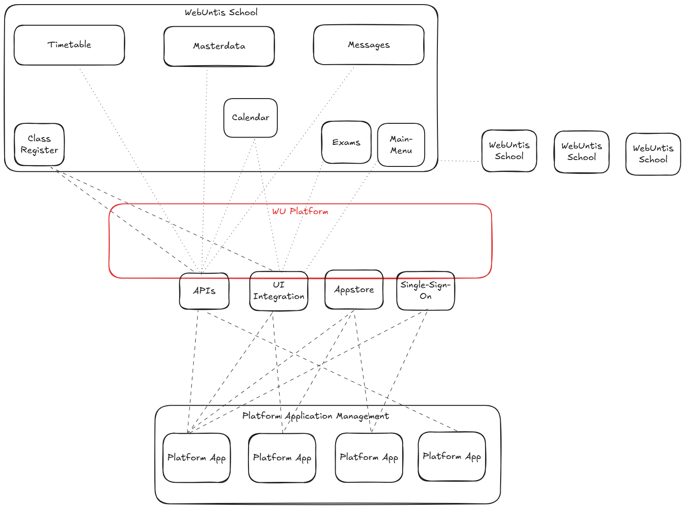

# Overview

> Source: Untis GmbH developer documentation, `developer.untis.com/getting-started/overview/`.
> Reproduced here as an offline mirror so this repository is self-contained.
> © Untis GmbH; see [`NOTICE.md`](../../../NOTICE.md).

---

## The Untis Platform

The Untis Platform is the integration layer for connecting platform applications with Untis Platform. It provides a consistent set of building blocks — **UI integration**, **Data exchange via APIs**, and **Single Sign-On** — that platform applications combine depending on their use case.

## Integration building blocks

Platform applications are built from three building blocks. You can combine them freely depending on your use case.

[UI Integration](integration-guides-ui-integration.md)  Embed your application directly inside Untis Platform and Untis Mobile.

[Single Sign-On](integration-guides-sso.md)  Authenticate users via the Untis Platform as identity provider — no separate login required.

[API Integration](api-reference-api-overview.md)  Exchange school data using the Untis Platform REST API or OneRoster API.

## Platform applications

A **platform application** is the unit of integration on the Untis Platform. It represents your product’s registration and holds the full configuration for how your application integrates: which UI entry points it appears in, which APIs it can access, how users are authenticated, and how credentials reach your system.

Everything in this documentation — authentication flows, webhook endpoints, API access, UI entry points — is scoped to a platform application.

### Platform application manager

Platform applications are configured in the **platform application manager (PAM)**. This is the app store for Untis Platform integrations: school administrators browse available applications and activate the ones they want to use. Once activated, the application becomes available to the school’s users according to its configured entry points and role visibility.

Follow [Get Your Platform Application](getting-started-get-platform-application.md) to request your platform application setup.

### Credential transfer

When a school activates your platform application, the platform provisions a set of credentials for that school to your system. This is called **credential transfer**. Two modes are supported:

- **Automatic (recommended)**: the platform sends credentials to your endpoint via a webhook at activation time.
- **Manual**: the school administrator copies credentials from the platform and enters them into your system manually.

Automatic transfer is strongly recommended — manual transfer does not scale and is error-prone. See [Credentials Webhook](integration-guides-webhooks-credentials.md) for implementation details.

Platform applications are **tenant-aware**: each school is a separate tenant. Credentials are provisioned per school and must be stored and used per school. A single set of credentials cannot be used across multiple schools.

## Explore the documentation

Getting Started

Onboarding, quick start guide, and how to request your platform application.

[Quick Start Guide](getting-started-quick-start.md) · [Get Your Platform Application](getting-started-get-platform-application.md)

Core Concepts

Authentication model, authorization model, and cross-cutting patterns.

[Authentication Model](core-concepts-authentication-model.md) · [Authorization Model](core-concepts-authorization-model.md)

API Reference

Which APIs to choose and how to use them — OneRoster and Untis Platform APIs.

[Which API to Choose](api-reference-which-api-to-choose.md) · [API Overview](api-reference-api-overview.md) · [Common Concepts](api-reference-common-api-concepts.md) · [Untis Platform APIs](api-reference-webuntis-apis.md) · [OneRoster APIs](api-reference-oneroster-apis.md)

Integration Guides

Task-oriented guides for UI integration, SSO, webhooks, and calendar.

[UI Integration](integration-guides-ui-integration.md) · [SSO](integration-guides-sso.md) · [Webhooks](integration-guides-webhooks.md) · [Calendar API](integration-guides-calendar.md) · [Example Workflows](integration-guides-example-workflows.md)
